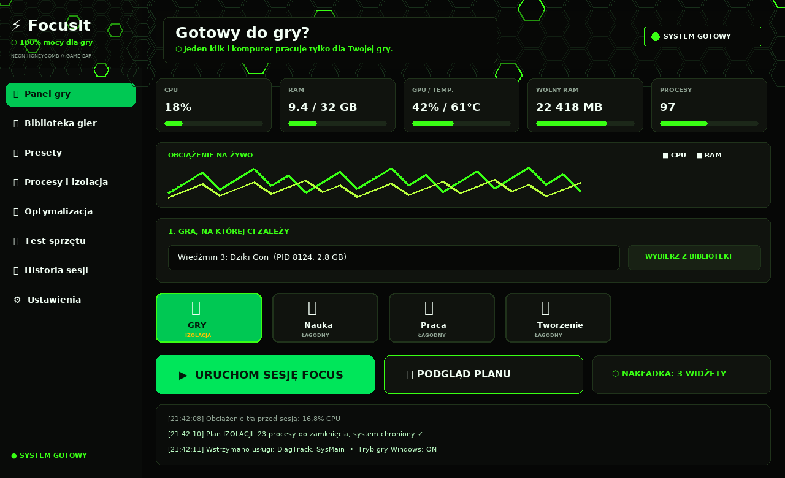

# ⚡ FocusIt



*Motyw **Neon Honeycomb**: matowa czerń, neonowa zieleń i plastry miodu. Wizualizacja układu — prawdziwy program w pliku .exe wygląda tak samo (kolory, karty, baner).* 

Program, który **jednym kliknięciem przygotowuje komputer do grania** (a przy okazji też do nauki czy pracy): zamyka wszystko, co niepotrzebnie zjada RAM i procesor, włącza wysoką wydajność i zostawia tylko to, na czym Ci zależy. Po sesji przywraca poprzedni stan.

> Program skupia się na **grach**. Pozostałe presety (Nauka, Praca, Tworzenie) są dodatkami.

---

## ☠ Tryb IZOLACJI — serce programu

To opcja, o którą chodziło: **„zabijaj każdy proces niezwiązany z grą, na której mi zależy”**.

1. Wybierasz grę/program z listy uruchomionych albo wskazujesz plik `.exe`.
2. Klikasz **👁 Podgląd planu** — FocusIt pokaże tabelę: co zamknie, co zachowa i **dlaczego**.
3. Odznaczasz **SYMULACJĘ** i klikasz **▶ URUCHOM SESJĘ FOCUS**.
4. Program zamyka zbędne procesy, ustawia plan zasilania „Wysoka wydajność” i wysoki priorytet gry.
5. Po graniu klikasz **■ ZAKOŃCZ I PRZYWRÓĆ** — plan zasilania wraca, a zamknięte aplikacje mogą same się ponownie otworzyć.

### 🔒 Czego FocusIt NIGDY nie zabije

Tryb izolacji jest agresywny, ale ma twarde zasady bezpieczeństwa. Program **nigdy** nie zamknie:

- procesów jądra i usług Windows (`svchost`, `csrss`, `lsass`, `winlogon`, `services`…),
- niczego z katalogu `C:\Windows` ani procesów kont systemowych / **innego użytkownika**,
- pulpitu i obsługi klawiatury (`explorer`, `dwm`, `ctfmon`…),
- sterowników grafiki i dźwięku (NVIDIA / AMD / Intel / Realtek) — gra ich potrzebuje,
- antywirusa (Windows Defender),
- wybranej gry, jej launchera, procesów potomnych (np. **anti-cheatu**) i programów z tego samego folderu co gra,
- procesów, do których nie ma dostępu (brak ścieżki = bezpiecznie pomijamy),
- aplikacji z Twojej listy „Zachowaj” (Ustawienia) — np. Discord, jeśli grasz ze znajomymi.

Każdy proces jest **ponownie sprawdzany tuż przed zamknięciem** (też pod kątem ponownego użycia PID), a najpierw dostaje grzeczną prośbę o zamknięcie — jak kliknięcie ✕. Dopiero uporczywe procesy są zamykane siłą.

Dodatkowo przy pierwszym uruchomieniu włączona jest **SYMULACJA**: program tylko pokazuje, co *by* zamknął. Na żywo działa dopiero po jej odznaczeniu i potwierdzeniu listy.

---

## 🎯 Presety

| Preset | Do czego | Tryb |
|---|---|---|
| 🎮 **Gry** | maksymalna wydajność dla wybranej gry | izolacja |
| 📚 **Nauka** | zamyka rozpraszacze + timer Pomodoro 25/5 | łagodny |
| 💼 **Praca** | zamyka prywatne rozpraszacze | łagodny |
| 🎬 **Tworzenie** | montaż/streaming/programowanie, wysoki priorytet | łagodny |

W zakładce **Presety** edytujesz istniejące i tworzysz **własne**: wybierasz, co zamykać, co uruchamiać, co zawsze zachować, plan zasilania, priorytet i timer.

## 📦 Jak uruchomić (Windows)

**Sposób 1 — najprostszy:** dwuklik na **`uruchom.bat`** (wymaga [Pythona](https://www.python.org/downloads/) — przy instalacji zaznacz *Add python.exe to PATH*).

**Sposób 2 — ręcznie:**
```bat
pip install -r requirements.txt
python FocusIt.py
```

**Sposób 0 — gotowy plik .exe (bez instalacji czegokolwiek):** pobierz `FocusIt.exe` z zakładki **[Releases](../../releases)** tego repozytorium i po prostu go uruchom (jeden plik, nic nie trzeba instalować).

**Sposób 3 — własny plik .exe:** dwuklik na **`build_windows.bat`** — w folderze `dist\` powstanie gotowy, pojedynczy `FocusIt.exe`. (To samo robi automatycznie GitHub Actions — plik `.github/workflows/build-exe.yml`.)

> Wskazówka: dla pełnego efektu (priorytet procesów, plan zasilania) uruchom program jako administrator — prawy przycisk myszy → *Uruchom jako administrator*.

## 🖥️ Co potrafi program (v1.6)

- **Panel gry** — gamingowy baner „Gotowy do gry?”, statystyki CPU/RAM/GPU na żywo z **wykresem i paskami obciążenia**, lista najcięższych procesów, presety jako klikalne karty, wielki przycisk start/stop sesji, dziennik zdarzeń,
- **🎮 Biblioteka gier** — automatyczne wykrywanie gier ze **Steam, Epic i GOG** (z okładkami Steama), dodawanie gier ręcznie oraz **własny profil dla każdej gry** (co zachować, co zamykać, tryb sesji),
- **Procesy i izolacja** — pełny podgląd planu z uzasadnieniem każdej decyzji; dwuklik na proces dodaje go do listy „Zachowaj”,
- **Presety** — edytor presetów wbudowanych (przez kopie) i własnych, eksport/import presetów do pliku (możesz wysłać znajomym),
- **🚀 Optymalizacja** — **Wynik kondycji PC (0–100)** ze wskazówkami, czyszczenie plików tymczasowych z podglądem, menedżer autostartu Windows (wyłączanie w pełni odwracalne), wstrzymywanie usług Windows na czas sesji, flush DNS, tworzenie punktu przywracania systemu,
- **📉 Mierzalna skuteczność** — program mierzy obciążenie procesów w tle (CPU) przed i po starcie sesji i pokazuje je w raporcie („tło: 18,4% → 2,1%”), zamiast obiecywać magiczne „+100 FPS”,
- **🧪 Test sprzętu i auto-dopasowanie** — rozbudowany benchmark (CPU 1/wiele rdzeni, throttling, latencja RAM, dysk 4K IOPS, GPU) z inwentaryzacją sprzętu, oceną klasy komputera, automatycznymi ustawieniami FocusIt oraz **dopasowaniem grafiki w grach Unreal Engine** (np. Fortnite) z kopią zapasową ustawień,
- **⚙ Windows na 100%** — raport optymalizacji systemu (Tryb gry, Game DVR, HAGS, VBS, TRIM, Hz monitora), sesyjny plan zasilania bez parkowania rdzeni i oszczędzania PCIe/USB, wyłączanie nagrywania w tle i timera 1 ms tylko na czas gry, exclusive fullscreen dla wybranej gry — wszystko odwracalne,
- **🪟 Nakładki w grze** — półprzezroczyste widżety (czas sesji, obciążenie, przyciski akcji) z edycją zestawu, przezroczystości i położenia,
- **🎮 Głębokie ustawienia** — Tryb gry Windows tylko na czas sesji, preferencja GPU „Wysoka wydajność” dla gry, plan „Wydajność maksymalna” — wszystko odwracalne,
- **Automatyzacja** — opcjonalna **auto-sesja**: FocusIt sam wykrywa start gry z biblioteki i włącza jej sesję, a po zamknięciu gry sam przywraca ustawienia; **mini-widget** sesji zawsze na wierzchu; **skrót globalny Ctrl+Alt+F**,
- **❄ Zamrażanie procesów** — zamiast zabijać zbędne procesy możesz je zamrozić (zero zużycia CPU, bez utraty niezapisanej pracy, wracają po sesji),
- **🛟 Bezpieczeństwo** — odzyskiwanie ustawień po awarii programu, ekran powitalny, sprawdzanie aktualizacji, inteligentne sugestie „co warto zamknąć przed grą”, powinowactwo CPU w profilu gry, wykres historii sesji,
- **Historia sesji** — ile procesów zamknięto (przed → po), ile RAM-u szacunkowo zwolniono, jak długo trwały sesje,
- **Ustawienia** — globalna lista „Zachowaj”, przywracanie aplikacji i planu zasilania po sesji, potwierdzenia bezpieczeństwa,
- zapis ustawień w `%APPDATA%\FocusIt` (config + historia).

## ⌨️ Wersja tekstowa (CLI)

```bat
python FocusIt.py --cli stats
python FocusIt.py --cli list
python FocusIt.py --cli plan --target game.exe --mode isolation --all
python FocusIt.py --cli presets
```
`plan` to zawsze tylko podgląd — niczego nie zamyka.

## 🧪 Testy

```bat
pip install -r requirements.txt
python -m unittest discover -s tests
```
Testy sprawdzają m.in., że tryb izolacji nigdy nie wskaże do zabicia procesów systemowych, sterowników, anti-cheatu gry ani procesów innego użytkownika.

## 🗂️ Struktura projektu

```
FocusIt.py          <- start programu (okno / --cli)
uruchom.bat         <- launcher dla Windows
build_windows.bat   <- budowanie FocusIt.exe (PyInstaller)
focusit/core.py     <- silnik: klasyfikacja procesów, bezpieczeństwo, sesje, presety
focusit/gui.py      <- interfejs graficzny (Tkinter, ciemny motyw)
focusit/cli.py      <- wersja tekstowa
tests/test_core.py  <- testy bezpieczeństwa silnika
```

## ⚠️ Uwaga

Zamykaj tylko to, czego nie potrzebujesz — niezapisana praca w zamykanych programach może przepaść (dlatego najpierw wysyłana jest prośba o zamknięcie, a nie „strzał w głowę”). Zacznij od SYMULACJI i podglądu planu.

## 🗺️ Pomysły na rozwój

- automatyczne wykrycie uruchomienia gry i start sesji,
- nakładka z FPS/temperaturą podczas gry,
- widget w zasobniku systemowym,
- blokowanie stron internetowych w presecie Nauka,
- wykrywanie zainstalowanych gier (Steam/Epic) i gotowe profile pod konkretne tytuły.
